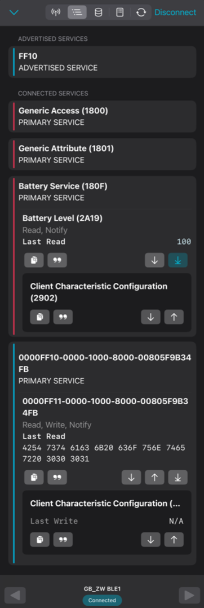
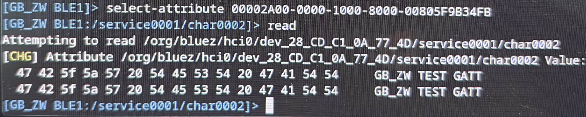

# Lab 11 Results
## Advertising

## Attributes, Services, & Characteristics

  - Services and characteristics match those configured in `gatt_counter.gatt` and their values update correctly following `gatt_counter.c`.

  - iOS restricts access to the GAP service such that applications can't access its characteristics, so we were unable to read the `GAP_DEVICE_NAME` characteristic from our iOS scanner application. However, we verified its value using `bluetoothctl` on Linux, as shown above.